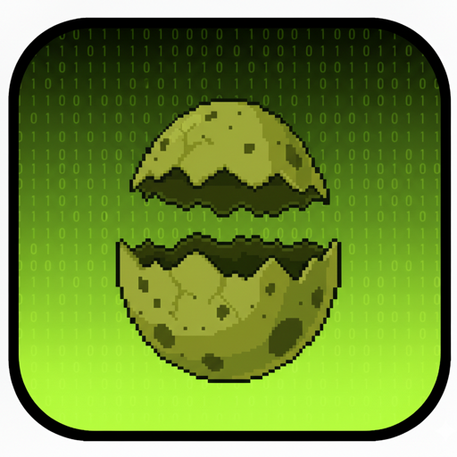
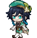
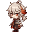
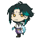
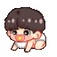
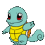
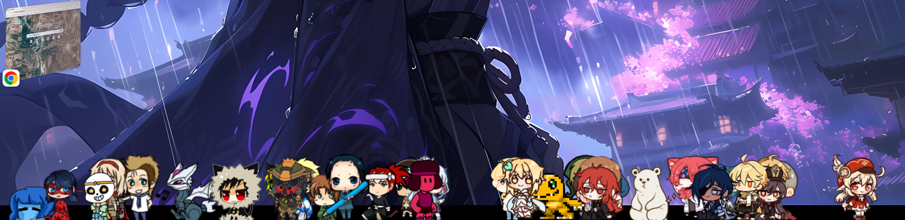
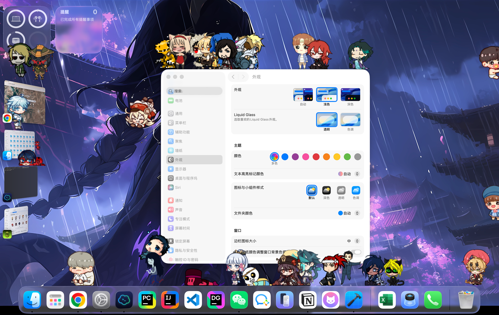
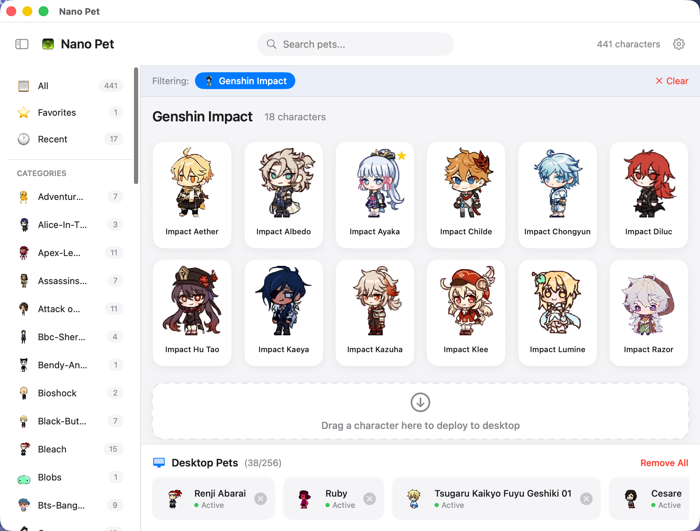
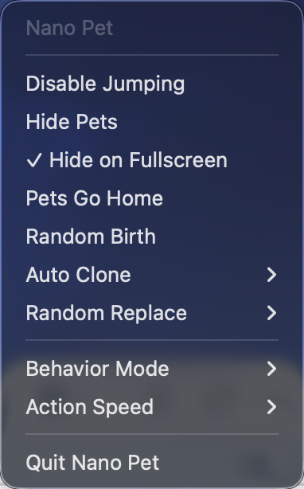

<div align="center">
  
  <h1>🐾 Nano Pet</h1>
  <p><strong>✨ Desktop Shimeji for macOS ✨</strong></p>
  <p>Adorable desktop companions that walk, climb, and interact with your windows</p>

  <p><strong><a href="https://github.com/Poseima/nano-pet/releases/download/v1.0.0/Nano.Pet.1.0.0.dmg">⬇️ Download for Mac / 下载 Mac 安装包 (v1.0.0)</a></strong></p>
  <p>macOS 14+ · No coding or Xcode required<br>Download → Open the DMG → Drag Nano Pet into Applications<br>点击下载 → 打开 DMG → 拖入“应用程序”</p>
  <p><a href="https://github.com/Poseima/nano-pet/releases/latest">Latest release &amp; release notes / 最新版本与更新说明</a></p>

  <p>
    <a href="../../releases/latest"></a>
    <a href="../../releases"></a>
    
  </p>

  <p>
    
    
    
    
  </p>

  <p>
    <a href="README_CN.md">🇨🇳 中文</a> | 🇺🇸 English
  </p>

  <!-- Character GIF Showcase -->
  <p>
    
    
    
    
    
    
    
    
    
    
  </p>
</div>

---

## 🎬 Showcase

<div align="center">
  
  <p><em>🎉 A parade of pets walking along your dock!</em></p>
</div>

<div align="center">
  
  <p><em>🌟 Random mode: pets roam freely across your entire desktop</em></p>
</div>

---

## 🏠 The Nest

<table>
  <tr>
    <td align="center" width="60%">
      
      <br><em>📚 Character picker with category sidebar</em>
    </td>
    <td align="center" width="40%">
      
      <br><em>⚙️ Quick menu</em>
    </td>
  </tr>
</table>

---

## ✨ Features

### 🎮 Core Features
| Feature | Description |
|---------|-------------|
| 🐕 **Desktop Pets** | Cute animated characters that roam freely on your desktop |
| 🪟 **Window Interaction** | Pets walk on window title bars, climb edges, and jump between windows |
| ⚡ **Physics Engine** | Realistic gravity, collision detection, and smooth animations |
| 🎨 **60+ Characters** | Pokemon, Genshin Impact, BTS, Mario, anime characters and more |

### 🎭 Behavior Modes
- 🎲 **Random Mode** — Pets wander everywhere, climb windows, and perform random actions
- 🎯 **Focus Mode** — Pets stay at the bottom of screen or on the dock, less distracting for work

### 🤖 Automation
- 👯 **Auto Clone** — Automatically spawn new pets at set intervals
- 🔀 **Random Replace** — Periodically swap pet characters for variety
- ⏱️ **Adjustable Speed** — Control how often pets perform actions (Slow/Medium/Fast)

### 🧠 Smart Features
- 🖥️ **Fullscreen Detection** — Automatically hides pets when you enter fullscreen apps
- 👁️ **Window Awareness** — Pets can detect and interact with application windows
- 🖥️ **Multi-display Support** — Works across all your monitors

### 🎨 Customization
- 📦 **Import Custom Characters** — Add your own Shimeji sprite packs
- ⭐ **Favorites & Recent** — Quick access to your favorite characters
- 📂 **Category Organization** — Browse characters by series (Pokemon, Genshin, etc.)

### 🌍 Localization
- 🗣️ **Bilingual Support** — Full English and Chinese interface
- 🔄 **In-app Language Switch** — Change language without restarting

---

## 📥 Installation

### 💾 Download and install

**[⬇️ Download Nano Pet for Mac (v1.0.0, about 318 MB)](https://github.com/Poseima/nano-pet/releases/download/v1.0.0/Nano.Pet.1.0.0.dmg)** · [Latest release](https://github.com/Poseima/nano-pet/releases/latest)

1. Click the download link above and save `Nano.Pet.1.0.0.dmg`.
2. Open the DMG and drag **Nano Pet** into **Applications**.
3. Open **Nano Pet** from Applications, then click its menu bar icon to get started.

No coding or Xcode required. GitHub's **Code → Download ZIP** downloads the source code; to use the app, download the **DMG installer** above.

If macOS says the developer cannot be verified or Apple cannot check the app for malicious software, first confirm that you downloaded it from this repository's official release page, then go to **System Settings → Privacy & Security → Open Anyway** to confirm. [Apple's instructions](https://support.apple.com/en-us/102445)

### 🔨 Build from Source

```bash
git clone https://github.com/Poseima/nano-pet.git
cd nano-pet
open "Nano Pet.xcodeproj"
```

Build and run with Xcode 15+ on macOS 14+.

---

## 🚀 Usage

### 🏁 Getting Started
1. **🖱️ Launch** — Click the menu bar icon to open the character picker
2. **🎯 Deploy** — Click any character to add it to your desktop (or drag to the drop zone)
3. **📋 Manage** — View active pets in the "Desktop Pets" section at the bottom

### 🎛️ Menu Bar Controls
| Action | Result |
|--------|--------|
| 🖱️ **Left-click** | Open character picker window |
| 🖱️ **Right-click** | Quick menu for common actions |

### ⚡ Quick Menu Options
| Option | Description |
|--------|-------------|
| 🚫 Disable Jumping | Prevent pets from jumping |
| 👻 Hide Pets | Temporarily hide all pets |
| 🖥️ Hide on Fullscreen | Auto-hide when in fullscreen apps |
| 🏠 Pets Go Home | Remove all pets from desktop |
| 🎲 Random Birth | Spawn a random character |
| 👯 Auto Clone | Periodically duplicate pets |
| 🔀 Random Replace | Periodically change pet characters |
| 🎭 Behavior Mode | Switch between Random and Focus modes |
| ⏱️ Action Speed | Control animation frequency |

---

## 🎨 Adding Custom Characters

Nano Pet supports standard Shimeji sprite packs:

1. 📁 Prepare a folder with sprite images named `shime1.png`, `shime2.png`, etc.
2. 📂 Open the app and go to Asset Manager
3. 🖱️ Drag the folder into the import area
4. ✅ Your character will appear in the character picker

### 📐 Sprite Requirements
| Requirement | Value |
|-------------|-------|
| 📄 Format | PNG with transparency |
| 📏 Size | 128x128 pixels (recommended) |
| 🔢 Naming | `shime1.png` through `shime46.png` |

---

## 🛠️ Tech Stack

<p align="center">
  
  
  
</p>

- **SwiftUI** — Modern declarative UI framework
- **AppKit** — Native macOS window management
- **Core Graphics** — Efficient sprite rendering
- **Combine** — Reactive state management

---

## ⚠️ Disclaimer

The character sprites included in this repository are fan-made Shimeji assets collected from various sources. All characters belong to their respective copyright holders:

| Franchise | Copyright |
|-----------|-----------|
| 🎮 Pokemon | © Nintendo/Game Freak |
| ⚔️ Genshin Impact | © miHoYo/HoYoverse |
| 🎤 BTS | © respective artists |
| 🍄 Mario | © Nintendo |
| 📺 Anime | © their respective studios |

**🎓 This project is for educational and personal use only.**

---

## 🤝 Contributing

Contributions are welcome! Please feel free to submit issues and pull requests.

1. 🍴 Fork the repository
2. 🌿 Create your feature branch (`git checkout -b feature/amazing-feature`)
3. 💾 Commit your changes (`git commit -m 'Add amazing feature'`)
4. 📤 Push to the branch (`git push origin feature/amazing-feature`)
5. 🎉 Open a Pull Request

---

## 📄 License

This project is licensed under the MIT License - see the [LICENSE](LICENSE) file for details.

> **Note:** The MIT license applies to the application code only. Character sprites and assets have separate copyrights belonging to their respective owners.

---

<div align="center">
  <p>
    
    
    
    
    
  </p>

  <p>Made with ❤️ for desktop pet lovers</p>

  <p>
    <a href="../../stargazers">⭐ Star this repo if you like it!</a>
  </p>
</div>
