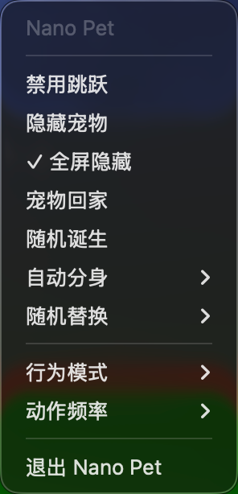

<div align="center">
  
  <h1>Nano Pet</h1>
  <p><strong>macOS 桌面宠物</strong></p>
  <p>可爱的桌面伙伴，能在桌面上行走、攀爬并与窗口互动</p>

  <p>
    <a href="../../releases/latest"></a>
    <a href="../../releases"></a>
    
  </p>

  <p>
    中文 | <a href="README.md">English</a>
  </p>

  <!-- 角色动图展示 -->
  <p>
    
    
    
    
    
    
    
    
    
    
  </p>
</div>

---

## 效果展示

<div align="center">
  
  <p><em>宠物们在 Dock 栏上列队行走！</em></p>
</div>

<div align="center">
  
  <p><em>随机模式：宠物在整个桌面上自由漫步</em></p>
</div>


---

## 小窝展示

<table>
  <tr>
    <td align="center" width="60%">
      
      <br><em>带分类侧边栏的角色选择器</em>
    </td>
    <td align="center" width="40%">
      
      <br><em>快捷菜单</em>
    </td>
  </tr>
</table>

---

## 功能特性

### 核心功能
- **桌面宠物** — 可爱的动画角色在桌面上自由漫步
- **窗口互动** — 宠物可以在窗口标题栏上行走、攀爬边缘、在窗口间跳跃
- **物理引擎** — 真实的重力、碰撞检测和流畅的动画
- **60+ 角色** — 宝可梦、原神、BTS、马里奥、动漫角色等（20,000+ 动画帧）

### 行为模式
- **随机模式** — 宠物到处游荡、攀爬窗口、执行随机动作
- **专注模式** — 宠物停留在屏幕底部或 Dock 上，工作时不打扰你

### 自动化功能
- **自动分身** — 按设定间隔自动生成新宠物
- **随机替换** — 定期更换宠物角色，增加多样性
- **速度调节** — 控制宠物执行动作的频率（慢/中等/快）

### 智能功能
- **全屏检测** — 进入全屏应用时自动隐藏宠物
- **窗口感知** — 宠物可以检测并与应用程序窗口互动
- **多显示器支持** — 在所有显示器上工作

### 自定义
- **导入自定义角色** — 添加你自己的 Shimeji 素材包
- **收藏与最近** — 快速访问你喜欢的角色
- **分类整理** — 按系列浏览角色（宝可梦、原神等）

### 本地化
- **双语支持** — 完整的中英文界面
- **应用内切换** — 无需重启即可切换语言


---

## 安装

### 下载

1. 从 [Releases](../../releases) 下载 `Nano.Pet.dmg`
2. 打开 DMG 文件，将 **Nano Pet** 拖入应用程序文件夹
3. 从应用程序启动

> **提示：** 首次启动时，可能需要右键点击选择"打开"来绕过 Gatekeeper 安全验证。

### 从源码构建

```bash
git clone https://github.com/user/nano-pet.git
cd nano-pet
open "Nano Pet.xcodeproj"
```

使用 Xcode 15+ 在 macOS 14+ 上构建运行。

---

## 使用方法

### 快速开始
1. **启动** — 点击菜单栏图标打开角色选择器
2. **部署** — 点击任意角色将其添加到桌面（或拖拽到放置区）
3. **管理** — 在底部的"桌面宠物"区域查看活跃的宠物

### 菜单栏控制
- **左键点击** — 打开角色选择器窗口
- **右键点击** — 快捷菜单

### 快捷菜单选项
| 选项 | 描述 |
|------|------|
| 禁用跳跃 | 阻止宠物跳跃 |
| 隐藏宠物 | 临时隐藏所有宠物 |
| 全屏隐藏 | 全屏应用时自动隐藏 |
| 宠物回家 | 移除桌面上的所有宠物 |
| 随机诞生 | 生成一个随机角色 |
| 自动分身 | 定期复制宠物 |
| 随机替换 | 定期更换宠物角色 |
| 行为模式 | 在随机和专注模式间切换 |
| 动作频率 | 控制动画频率 |

---

## 添加自定义角色

Nano Pet 支持标准 Shimeji 素材包：

1. 准备一个包含精灵图片的文件夹，命名为 `shime1.png`、`shime2.png` 等
2. 打开应用，进入素材管理器
3. 将文件夹拖入导入区域
4. 你的角色将出现在角色选择器中

### 素材要求
- PNG 格式，带透明通道
- 推荐尺寸：128x128 像素
- 标准 Shimeji 帧编号（`shime1.png` 到 `shime46.png`）

---

## 技术栈

- **SwiftUI** — 现代声明式 UI 框架
- **AppKit** — 原生 macOS 窗口管理
- **Core Graphics** — 高效精灵渲染
- **Combine** — 响应式状态管理

---

## 免责声明

本仓库中包含的角色素材是从各种来源收集的粉丝制作的 Shimeji 素材。所有角色归其各自版权所有者所有：

- 宝可梦角色 © Nintendo/Game Freak
- 原神角色 © 米哈游/HoYoverse
- BTS 粉丝画作 © 各自创作者
- 马里奥角色 © Nintendo
- 动漫角色 © 各自工作室

**本项目仅供教育和个人使用。**

---

## 贡献

欢迎贡献！请随时提交 issues 和 pull requests。

1. Fork 本仓库
2. 创建特性分支 (`git checkout -b feature/amazing-feature`)
3. 提交更改 (`git commit -m 'Add amazing feature'`)
4. 推送到分支 (`git push origin feature/amazing-feature`)
5. 开启 Pull Request

---

## 许可证

本项目采用 MIT 许可证 - 详见 [LICENSE](LICENSE) 文件。

**注意：** MIT 许可证仅适用于应用程序代码。角色素材和资源有各自的版权，归其各自所有者所有。

---

<div align="center">
  <p>
    
    
    
    
    
  </p>
  <p>为桌面宠物爱好者用心制作 ❤️</p>
</div>
